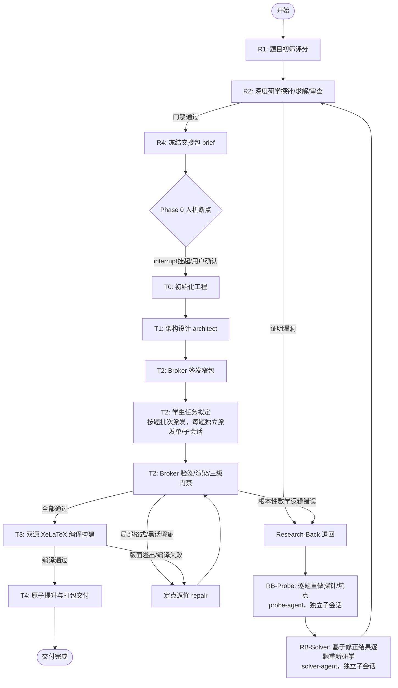

# 竞赛教研与学案制作一体化系统（LangGraph 架构版）

本技能将原 `skills-secured` 的复杂状态机、密码学门禁核验与单源双输出排版构建，重构为由 **LangGraph（StateGraph）** 托管的确定性计算图。

**核心哲学转变（控制权外生化）**：
- **图引擎驱动主干**：流程的前进、分支、门禁判定、返修循环（`REPAIR_TASK`）与数学退回（`RESEARCH_BACK`）全部由 LangGraph 确定性代码流转，**主 Agent 不再充当底层状态调度器或手工执行命令的运维**。
- **物理人机断点（Native Interrupt）**：通过 LangGraph 原生 `interrupt()` 挂起，严格强制 Phase 0 用户确认，杜绝无声跳步与伪造握手。
- **可恢复与时间旅行（Durable Checkpoint）**：每个节点自动记录状态快照，支持随时查看状态、诊断错误或无损恢复。

---

## 状态拓扑结构概览



---

## 主 Agent 操作指南

### 方式一：🚀 Web UI 可视化控制台（强烈推荐，小白友好）
通过启动器一键拉起全功能 Web UI 控制台。流水线引擎可置于硬盘任意路径，支持点击“📁 浏览选择文件夹”通过操作系统文件管理器选择输入文件夹与输出工作区，并在界面中填写 Phase 0 确认表单、实时追踪 DAG 状态、查看门禁体检报告与下载双源 PDF：

```powershell
# 在根目录双击 start_courseware_ui.bat 或在任意位置执行：
python skills-langgraph/launcher.py
```

### 方式二：命令行 CLI 交互模型
若在无头服务器或自动化脚本中运行：

#### 第一步：启动流水线
在工作区直接通过 CLI 驱动 LangGraph 引擎启动：

```powershell
python workflow/runner.py --project . --run
```

流水线将自动运行 R1 题目评分、R2 研学结构核验与 R4 冻结。当到达 Phase 0 时，图引擎将**自动在断点处安全挂起**。

#### 第二步：处理 Phase 0 断点对齐
当检测到流水线挂起在 `Phase 0 Breakpoint` 时，主 Agent 向用户确认：
1. **学案主标题**（`main_title`）
2. **教学模式**（`lesson_mode`：唯一取值 `guided` 分步引导，向用户说明后确认）

获得用户明确确认后，运行恢复指令（`--auth-token` 为必传的人工授权码，
由系统在挂起时写入 `<project>/.langgraph/phase0_token.txt`，**仅供真人用户查阅**，
主 Agent 必须请真人提供，严禁自行读取该文件）：

```powershell
python workflow/runner.py --project . --resume --title "<用户确定的主标题>" --mode guided --auth-token "<真人提供的授权码>"
```

缺失或错误的授权码将被 `[PERMISSION_DENIED]` 拒绝，断点继续保持挂起。

#### 第三步：监控与状态查询
随时可以查询当前流转状态与历史轨迹：

```powershell
python workflow/runner.py --project . --status
```

---

## 异常与自动流转机制

- **局部小问返修（`REPAIR_TASK`）**：若 `check_student_task.py` 检测到引导黑话越界、字符预算超限或小问格式不合规，图引擎自动路由至 `repair_small_output` 节点，重试提交，无需重跑教研。
- **T2 学生任务自审（默认开启）**：T2 批次产物落盘后先按题派发自审子 agent（role=`student-task-review`，产物 `review-student.json`，可定点修复 `student-task.json`），再进入核验与三重门禁；自审子 agent 持有 teacher-solution packet（完整证明视野），核验每条证明义务被 obligation_refs 覆盖、末位小问收束到原题结论。仅当项目 `config.yaml` 显式写 `enable_t2_self_review: false` 才关闭。
- **数学漏洞退回（`RESEARCH_BACK`）**：若检测到实质性解法错误，图引擎自动吊销 `freeze.json`，随后按 **probe → solver 两阶段**重做教研：先为每题派发探针/坑点重做（role=`probe`），全部完成后再为每题派发重新研学（role=`solver`），全部产物逐单校验后回到 R2。每题一个独立派发单与子会话，probe 与 solver 的会话 ID 必须互异。
- **交付保障**：所有交付物必须经 `T4` 节点的 `broker.run_gates` 并在干净代码副本中通过，由 `broker.promote` 执行原子提权，写入 `release/manifest.json`。
