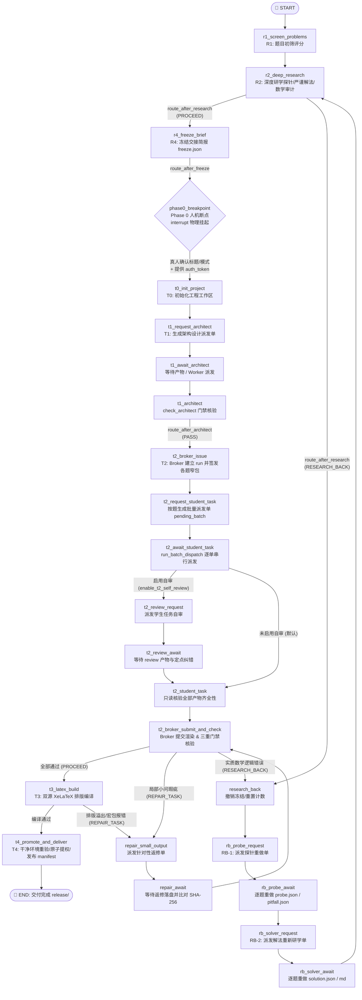

# LangGraph 竞赛教研与学案制作流水线工作流 (workflow)

> 本模块是竞赛教研与学案制作系统的**核心控制平面（Control Plane）**，基于 **LangGraph** 实现确定性强类型状态机编排，实现教研筛选、深度研学、人机断点对齐、架构设计、窄包派发、XeLaTeX 编译与原子交付全流程的自动化与安全闭环。

---

## 一、 设计哲学与三层解耦架构

传统大语言模型（LLM）在面对数十步的长链路复杂教研任务时，容易因上下文膨胀而导致**状态遗忘、步骤遗漏、伪造签名与循环失控**。

`workflow` 模块的核心设计思想是**控制权外生化（Externalized Control Plane）**，将流程控制权从不可信的 LLM 提示词中彻底剥离，交由确定性的代码图引擎托管，确立清晰的三层解耦架构：

```
+-----------------------------------------------------------------------------------+
| 1. 控制平面 (Control Plane) - 由 workflow/ 强类型 StateGraph 驱动                 |
|    - 强类型状态 CoursewareState: 全链路状态转移、分支路由、错误熔断、SQLite 检查点持久化|
|    - 原生断点 interrupt(): 物理级挂起 Phase 0 用户确认与缺省 Worker 认知派发        |
+-----------------------------------------------------------------------------------+
                                         │
                                         ▼
+-----------------------------------------------------------------------------------+
| 2. 算力与认知层 (Cognitive Workers) - 专职 Worker 与子 Agent                       |
|    - 角色划分: Probe / Solver / Math-Audit / Architect / Student-Task / Review     |
|    - 无状态与会话隔离: 每次派发携带纯净上下文与独立 Session ID，图引擎只负责派发与核验  |
+-----------------------------------------------------------------------------------+
                                         │
                                         ▼
+-----------------------------------------------------------------------------------+
| 3. 安全与执行基底 (Execution Enclave) - scripts/ 保持只读运行                      |
|    - broker.py: HMAC 签名、窄包签发、确定性渲染、原子提权                         |
|    - check_*.py: 11 项质量与排版门禁、XeLaTeX 盒模型检查、合规性穿透校验            |
+-----------------------------------------------------------------------------------+
```

---

## 二、 模块目录结构

```
workflow/
├── __init__.py                # 延迟导出入口 (State, Graph, Runner 函数)
├── state.py                   # CoursewareState / GateReport 强类型状态字典
├── graph.py                   # StateGraph 装配 (23 个节点注册与条件边连接)
├── edges.py                   # 条件路由函数 (分流器、自愈判定与 HALT 熔断)
├── runner.py                  # CLI 与 Python API 统一驱动器、跨进程断点恢复
├── state.py                   # 全局上下文强类型定义
├── nodes/                     # 流程执行节点分类
│   ├── research_nodes.py      # R1 题目初筛评分、R2 深度研学、R4 简报冻结
│   ├── human_nodes.py         # Phase 0 人机断点 (LangGraph native interrupt) 与授权码门禁
│   ├── teaching_nodes.py      # T0 初始化、T1 架构计划核验、T2 Broker 窄包签发与三重门禁
│   ├── build_nodes.py         # T3 双源 XeLaTeX 编译构建、T4 原子提权与最终交付
│   ├── repair_nodes.py        # 定点小问返修派发、Research-Back 退回与撤销冻结
│   └── agent_nodes.py         # 认知工位批次派发引擎 (run_batch_dispatch & 快照比对)
├── adapters/                  # 隔离与通信适配器
│   ├── script_runner.py       # 安全调用底层 scripts/ 脚本与解析门禁报告
│   ├── llm_worker.py          # 认知工位 Prompt 与 JSON Schema 装配适配器
│   └── worker_registry.py     # 多角色认知 Worker 注册表 (角色优先、会话隔离)
├── checkpoints/               # 状态持久化
│   └── sqlite_saver.py        # 跨进程持久化 SqliteSaver，支持断点落盘与恢复
└── ui/                        # Web UI 工作台
    ├── app.py                 # Gradio 可视化交互界面
    ├── folder_picker.py       # Windows 原生文件夹选择弹窗适配
    └── pipeline_manager.py    # 驱动引擎状态桥接与解耦工作区管理
```

---

## 三、 完整状态机与拓扑流转 (StateGraph Topology)

整个流水线由确定性的 DAG 主线及两条自愈/打回环路构成：



---

## 四、 核心机制与安全契约

### 1. 认知工位批次派发引擎 (`run_batch_dispatch`)
图引擎不直接包含大模型调用逻辑，所有涉及认知创造的环节（架构计划、学生小问、探针重演、解法返修）均通过统一的派发引擎流转：
- **逐单串行派发、逐单 SHA-256 校验**：派发前记录目标文件哈希快照。若执行后文件未生成或内容与派发前完全一致，直接标记 `HALT` 并中止流程，**绝不进行无变更的虚假门禁重跑**。
- **状态感知与断点续跑**：已在 `dispatch_results` 中标记 `ok` 的工单在恢复续跑时自动跳过，不重复消耗 Token。
- **单题独立会话隔离**：T2 学生任务和 Research-Back 均采用单题单派发单（`pending_dispatch_batch`）。单次派发只提供当前题目的窄包上下文，杜绝跨题泄露或串题。
- **优雅挂起**：若未注入可用 Worker，引擎自动调用 `interrupt()` 挂起，生成结构化挂起负载供外部工具或人工介入。

### 2. 多角色 Worker 注册表 (`worker_registry`)
系统支持通过 `workflow.adapters.worker_registry` 灵活接入认知算力：
- **角色优先、回退默认**：可通过 `set_role("probe", fn)`、`set_role("solver", fn)`、`set_role("student-task-review", fn)` 注入不同角色的专用模型，未指定角色的则回退到 `set(default_fn)`。
- **硬性隔离契约**：**每次 Worker 调用必须是全新的上下文会话**，严禁在不同工单或不同题目间复用会话历史。图引擎负责校验产物与签名，会话隔离由注入端保证。

### 3. Phase 0 物理人机对齐断点与一次性授权码
为了彻底杜绝执行端 Agent“未经确认自行推进”或“假装用户已同意”：
- **原生挂起**：执行到 `node_phase0_breakpoint` 时，调用 LangGraph 原生 `interrupt()` 强制中断进程。
- **单次安全授权码（Auth Token）**：
  - 挂起前，系统生成 8 位随机 Hex 授权码写入 `<project>/.langgraph/phase0_token.txt`（仅供真人查阅，不放入 interrupt payload）。
  - 恢复时，传入参数必须包含严格匹配的 `auth_token`，否则断点保持挂起并返回 `[PERMISSION_DENIED]`。
  - 确认成功后立即物理销毁授权码文件（一次性失效）。

### 4. 零信任门禁矩阵与原子交付
在 `workflow` 执行过程中，自动化调度 `scripts/` 下的 11 项严格验证门禁：
1. `check_question_coverage.py`: 题目题号全集覆盖校验
2. `check_probe.py`: 特例探针、代数极端情况与等号成立条件校验
3. `check_solution.py`: 解法步骤闭环与零跳步校验
4. `check_research.py`: 研学成果子会话真实性与穿透校验
5. `freeze_brief.py`: 教学交接简报 SHA-256 密码学锁定
6. `check_architect.py`: 教学双轨架构设计合理性核验
7. `check_student_task.py`: 学生引导小问格式、字符预算与黑话禁令校验
8. `check_student_visibility.py`: 防泄露级别与核心策略不可见性门禁
9. `check_teaching.py`: 整体教学规范与题链逻辑校验
10. `build.py`: XeLaTeX 双源（学生版 A3 双栏、教师版教案）排版编译与版面溢出校验
11. `deliver.py`: 干净沙箱全门禁重验、原子提升提权并生成 `release/manifest.json`

---

## 五、 使用方式与实操指引

### 1. 🚀 启动现代化 Web UI 控制台（推荐）
提供解耦的文件选择器、DAG 实时进度看板、Phase 0 交互表单、门禁体检中心与 PDF 在线预览：

```powershell
# 在 comp 目录下执行：
python launcher.py

# 或双击批处理脚本：
start_ui.bat
```

### 2. 💻 CLI 命令行交互模式
适合自动化运维、CI/CD 管道或无桌面环境：

```powershell
# 1. 启动流水线（将在 Phase 0 自动挂起）
python -m workflow.runner --project "D:/path/to/project" --run --thread-id "session_001"

# 2. 查看当前状态与挂起任务
python -m workflow.runner --project "D:/path/to/project" --status --thread-id "session_001"

# 3. 真人确认后恢复执行（需查阅 .langgraph/phase0_token.txt 获取授权码）
python -m workflow.runner --project "D:/path/to/project" --resume \
    --title "模素数同余式与组合恒等式" \
    --mode guided \
    --thread-id "session_001" \
    --auth-token "a1b2c3d4"

# 4. 导出计算图 Mermaid 拓扑代码
python -m workflow.runner --visualize
```

### 3. 🐍 Python API 编程与 Worker 注入
将自定义模型或 Mock Worker 注入到流水线中：

```python
from workflow.runner import run_pipeline, resume_pipeline
from workflow.adapters.worker_registry import worker_registry

# 1. 定义并注册专职认知 Worker
def my_cognitive_worker(system_prompt: str, user_content: str) -> str:
    # 调用 OpenAI / Claude / Gemini API，返回生成的 JSON 内容
    return call_llm(system_prompt, user_content)

worker_registry.set(my_cognitive_worker, name="gpt-4o-worker")

# 也可按角色分别配置
worker_registry.set_role("probe", my_probe_fn)
worker_registry.set_role("solver", my_solver_fn)

# 2. 执行流水线
result = run_pipeline(
    project_root="D:/competition/courseware_proj",
    selected_problems=["1", "4", "9"],
    thread_id="thread_prod_01"
)

# 3. 处理挂起与恢复
if result.get("stage") == "PHASE0_BREAKPOINT":
    # 模拟真人输入后恢复
    resumed_result = resume_pipeline(
        user_response={
            "main_title": "组合数模算术专题",
            "lesson_mode": "guided",
            "confirmed": True,
            "auth_token": "真人查阅的token"
        },
        thread_id="thread_prod_01"
    )
```

---

## 六、 进阶配置 (`config.yaml`)

项目根目录下的 `config.yaml` 支持以下工作流控制开关：

```yaml
# 教学对齐配置（由 Phase 0 自动回写或人工指定）
user_alignment:
  confirmed: true
  main_title: "模素数的同余式与组合恒等式"
  lesson_mode: guided         # 教学模式（唯一取值 guided 分步引导）

# T2 学生任务自审开关（默认 false）
# 开启后，在生成 student-task 后先派发 student-task-review 专职子 Agent 自审纠错再进门禁
enable_t2_self_review: false

# 教学骨架覆盖保护
# 默认 false，严格保护人工已经修订的 materials.json / content/*.tex；开启时先自动备份再覆写
regenerate_materials: false

# R3 学生障碍研究与补充材料研究开关（默认 false，条件执行）
# 关闭时：check_research.py 对非空的 dossier.obstacles / dossier.supplements / brief.supplements
#         一律 fail-closed 拒收（fail 消息带 [ORPHAN_R3_DISABLED] 前缀）；默认交付
#         student.pdf / student_solution.pdf 不消费 R3 产物，LangGraph 流水线亦无 R3 节点
# 开启时：仅在交付教师版（teacher.pdf）或声明 separate_hint / separate_review 视图且已
#         打通 R3 产物到 materials.json 的消费链时使用；check_teaching.py §3d 对每条
#         R3 产物做孤儿引用闭合检查（fail 消息带 [ORPHAN_RESEARCH_ARTIFACT] 前缀）
enable_obstacle_study: false
```

---

## 七、 测试与质量验证

测试套件位于 `tests/` 目录下，包含单元测试、端到端集成测试、批次派发测试以及 16 项对抗绕过穿透矩阵：

```powershell
# 运行全部测试套件（严格要求 100% 通过）
python -m pytest tests/ -q

# 执行静态代码风格审查
python -m ruff check workflow/ tests/
```

- **测试沙箱机制**：使用 `tests/_fixture.py` 的 `FixtureWorkspace` 为每个测试动态创建临时工作区，严格避免对本地实际工程文件的污染。
- **状态重置保证**：每个测试用例均在 `setUp` / `tearDown` 中自动清空 `worker_registry`，防止多测试间 Worker 相互串扰。
